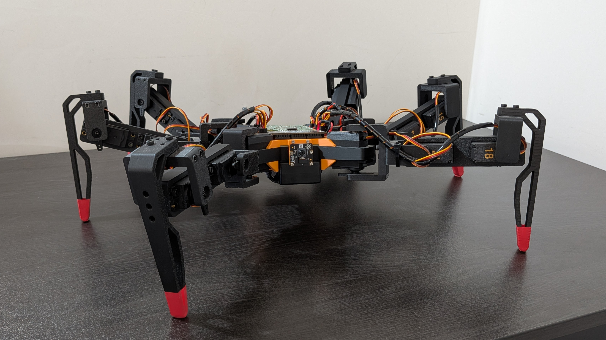
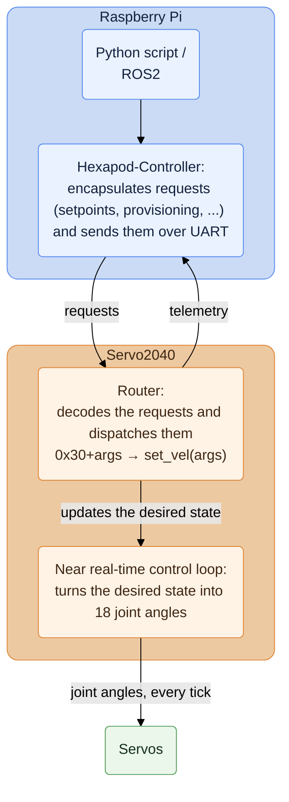

<div align="center">

# 🦾 The Hexapod Project

**A fully open-source, low-cost six-legged robot.**



</div>

## 🌍 Overview

This is an end-to-end reference for building and controlling a hexapod robot: 3D-printable parts and a bill of materials, an optional custom PCB, C++ firmware running the control loop on the robot, a Python wrapper on the Raspberry Pi, ROS2 nodes, and simulators.

Many hexapod resources are fragmented, require costly hardware or rely on closed components. A representative example is the [Make Your Pet hexapod](https://www.makeyourpet.com/), which is very good and has a huge active community, but depends on a proprietary application for inverse kinematics and gait generation. This project explicitly avoids that: everything is implemented in the open and thoroughly documented.

<div align="center">

<table>
  <tr>
    <td></td>
    <td></td>
  </tr>
</table>

</div>

## 🧠 Architecture

The main components of the robot are two boards: a Raspberry Pi and a Servo2040. The Raspberry Pi handles configuration, telemetry, and whatever high-level logic you put on top; the Servo2040 owns the near-real-time work.



The two boards talk over a UART link at 921600 baud, carrying CRC-framed binary messages.

Note that on the Servo2040 the router and the control loop are not a pipeline. A frame arriving only updates the desired state; the control loop never stops, and on each tick it reads whatever the current desired state is and turns it into joint angles. A late or dropped message therefore never stalls the robot: it simply keeps executing the last intent it was given, until the watchdog decides the link is gone and sits it down.

The control loop works on a kinematic frame and only maps into servo space at the very last step, which keeps the behaviour layer portable. The current version drives position-controlled servos.

## 🔧 Repositories

Each repository focuses on one aspect of the robot and documents it in depth.

<div align="center">

| Repository | What it is |
|---|---|
| [**Hexapod-Firmware**](https://github.com/ggldnl/Hexapod-Firmware) | C++17 firmware for the Servo2040: state machine, gait generator, IK, and the wire protocol |
| [**Hexapod-Controller**](https://github.com/ggldnl/Hexapod-Controller) | Pi-side Python client: opens the link, provisions the board from YAML configs, streams velocity/body pose setpoints, reads telemetry. Includes a servo calibration tool |
| [**Hexapod-Simulation**](https://github.com/ggldnl/Hexapod-Simulation) | PyBullet physics sim and a viser 3D visualizer, both driving the host-compiled firmware core |
| [**Hexapod-Hardware**](https://github.com/ggldnl/Hexapod-Hardware) | 3D-printable parts, full BOM and a step-by-step assembly guide |
| [**Hexapod-PCB**](https://github.com/ggldnl/Hexapod-PCB) | Optional custom PCB that simplifies the wiring and makes the assembly much cleaner |

</div>

For those working in a ROS2 ecosystem:

<div align="center">

| Repository | What it is |
|---|---|
| [**Hexapod-ROS-Python**](https://github.com/ggldnl/Hexapod-ROS-Python) | Wraps the Python controller as a ROS2 node, exposing the robot through topics, actions and services |
| [**Hexapod-Gazebo**](https://github.com/ggldnl/Hexapod-Gazebo) | Launch files to load the robot in Gazebo, taking the URDF and meshes straight from Hexapod-Hardware |

</div>

## ✨ Highlights

- **Fully documented binary protocol.** A compact HDLC-style framing (CRC-16/CCITT) over UART at 921600 baud, with three message kinds: fire-and-forget setpoints, request/reply queries, and acknowledged provisioning. Every opcode and payload is [specified byte-by-byte](https://github.com/ggldnl/Hexapod-Firmware#-communication-protocol).
- **Configure without reflashing.** The board ships with baked-in defaults and is fully functional standalone, but the Pi pushes the whole robot description (geometry, leg mounts, gait parameters, limits, per-servo calibration) from a single YAML file at connect time.
- **The simulation runs the real firmware.** The same C++ core is compiled into a shared library and driven by the same Python client through an in-process transport. Sim and hardware exercise the code, so what you tune in simulation is what the robot executes.
- **Safety.** A command watchdog sits the robot down and de-energizes it if the link goes quiet for 500 ms, a software over-current cutoff trips an emergency stop, and every command is clamped against velocity, joint and body-pose limits.

## 🚀 Getting started

**Try it without hardware.** [Hexapod-Simulation](https://github.com/ggldnl/Hexapod-Simulation) pulls in the firmware, controller and hardware repos as submodules, compiles the firmware core and runs it under PyBullet or viser (optionally including teleop with a gamepad):

```bash
git clone --recursive https://github.com/ggldnl/Hexapod-Simulation.git
cd Hexapod-Simulation
./bridge/build.sh
mamba env create -f environment.yml && mamba activate hexapod-sim
python -m simulation.bullet.main  # simulation.viser.main, simulation.bullet.teleop
```

**Drive the real robot.** Flash [the firmware](https://github.com/ggldnl/Hexapod-Firmware) on the Servo2040, install [the controller](https://github.com/ggldnl/Hexapod-Controller) on the Pi, and you are three lines away from walking:

```python
from hexapod import connect

bot = connect()                 # opens the serial link, provisions from default config.yml
bot.enable()                    # stand up
bot.set_velocity(120, 0, 0)     # vx, vy in mm/s, yaw rate in deg/s
print(bot.get_telemetry())      # state, odometry, voltage, current
bot.shutdown()                  # sit down and de-energize the motors
```

**Build one.** Start from [Hexapod-Hardware](https://github.com/ggldnl/Hexapod-Hardware) for the printed parts, the BOM and the assembly guide, then add [Hexapod-PCB](https://github.com/ggldnl/Hexapod-PCB) if you want to skip the wiring mess.

## 🔭 What's coming

- **Vision.** A camera on the robot, exposed as a ROS2 image topic so perception nodes can subscribe to it. Currently being worked on.
- **Force sensing.** Some form of contact feedback at the feet — a dedicated sensor, or joint torque estimated from current-controlled actuators — will open the door to terrain-adaptive gaits, reactive foot placement and other closed-loop locomotion strategies. This will likely lead to a redesign.

## 🤝 Contribution

Feel free to contribute by opening issues or submitting pull requests.
Give a ⭐️ to this project if you liked the content.
